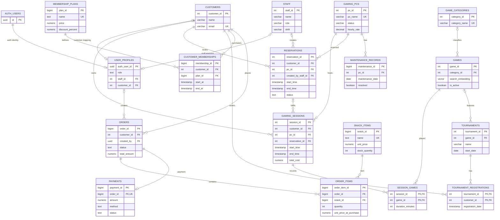

# GameHub — Entity–Relationship Diagram

**Integrated target model:** baseline `database/schema.sql`, `database/mvp_migration.sql`, and migrations `001`–`004`. This represents the complete application design, not only the original MVP.

## Complete ER diagram

## Cardinalities and interpretation

| Relationship | Cardinality | Implementation |
|---|---|---|
| Customer → Sessions | 1:N | Each session belongs to one customer; a customer has session history. |
| PC → Sessions | 1:N over time | Partial unique index allows at most one active session per PC. |
| Customer → Reservations | 1:N | Each reservation belongs to one customer. |
| PC → Reservations | 1:N over time | GiST exclusion constraint prevents overlapping confirmed reservations for the same PC. |
| Reservation → Sessions | 1:N optional | A session can reference a reservation; walk-ins have no reservation. |
| PC → Maintenance Records | 1:N | Each maintenance record belongs to one PC. |
| Session ↔ Game | M:N | Resolved by `SESSION_GAMES(session_id, game_id)`. |
| Tournament ↔ Customer | M:N | Resolved by `TOURNAMENT_REGISTRATIONS(tournament_id, customer_id)`. |
| Customer ↔ Membership Plan | M:N over time | Resolved by `CUSTOMER_MEMBERSHIPS`; only one active membership per customer. |
| Order ↔ Snack Item | M:N | Resolved by `ORDER_ITEMS`, with quantity and purchase-time price/name snapshots. |
| Order → Payment | 1:0..1 | `payments.order_id` is UNIQUE; payment may not yet exist. |
| Auth User → User Profile | 1:0..1 | Profile maps Supabase identity to application role. |

## Design notes

- `auth.users` is managed by Supabase Auth, not created by the GameHub schema.
- `USER_PROFILES` has a role/link CHECK: admin and staff profiles link to a staff row; customer profiles link to a customer row.
- The original maintenance weak-key `(pc_id, maintenance_date)` remains UNIQUE. Migration 003 adds `maintenance_id` as the operational PK.
- Migration 003 adds `duration_minutes` to `SESSION_GAMES`, while retaining legacy `play_duration_minutes`.
- Historical price snapshots are stored in sessions, memberships and order items.
- Analytics views are derived relations, not base entities: `vw_active_customer_memberships`, `vw_snack_sales_summary`, `vw_popular_games`, `vw_pc_usage_summary`, `vw_daily_revenue`.
- Constraints and triggers enforce billing, PC status, reservation conflicts, membership uniqueness, order totals, payment transitions, stock deduction and tournament capacity.
