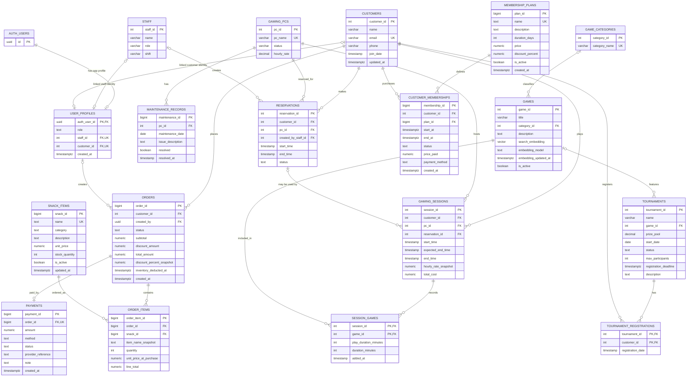

# GameHub — Entity–Relationship Diagram

**Scope:** integrated DBMS Level 3 design, based on the baseline schema and migrations `001_auth_foundation.sql` through `004_games_analytics.sql`.

This is the logical ER model for the integrated application. Supabase's `auth.users` is an external identity table; GameHub stores its role/domain mapping in `user_profiles`.

## Complete ER diagram

## Relationship and cardinality notes

| Relationship | Cardinality | Meaning |
|---|---|---|
| Customer–Gaming Session | 1:N | A customer can have many historical sessions; each session belongs to one customer. |
| Gaming PC–Gaming Session | 1:N | A PC hosts many sessions over time; the partial unique index permits at most one active session per PC. |
| Customer–Reservation / PC–Reservation | 1:N each | A customer can make multiple reservations; a PC can be reserved at different time slots. |
| Reservation–Gaming Session | 1:N optional link | A session may reference one reservation; a reservation can be referenced by multiple session rows over time unless application rules restrict it. |
| PC–Maintenance Record | 1:N | A PC can have multiple maintenance records; every record belongs to one PC. |
| Session–Game | M:N | Resolved by `session_games`, whose composite primary key is `(session_id, game_id)`. |
| Customer–Tournament | M:N | Resolved by `tournament_registrations`, whose composite primary key is `(tournament_id, customer_id)`. |
| Customer–Membership Plan | M:N over time | Resolved by `customer_memberships`; a partial unique index allows only one row with `status = 'active'` per customer. |
| Order–Snack Item | M:N | Resolved by `order_items`, which stores purchase-time name and price snapshots. |
| Order–Payment | 1:0..1 | Each order can have zero or one payment row; `payments.order_id` is UNIQUE. |
| Auth User–User Profile | 1:0..1 | A Supabase Auth user may have one GameHub profile. |
| User Profile–Staff / Customer | 1:0..1 | Profile links are optional individually, but a CHECK constraint requires exactly one staff link for admin/staff or one customer link for customer role. |

## Important modelling decisions

1. **Associative entities:** `session_games`, `tournament_registrations`, and `order_items` resolve many-to-many relationships and carry relationship-specific attributes.
2. **Maintenance identity:** the baseline weak-entity key `(pc_id, maintenance_date)` is retained as a UNIQUE constraint. Operations migration 003 adds `maintenance_id` as the primary key so multiple maintenance records can be managed consistently.
3. **Historical pricing:** `gaming_sessions.hourly_rate_snapshot`, `customer_memberships.price_paid`, and `order_items.unit_price_at_purchase` preserve the price used at the time of the transaction.
4. **Database-enforced rules:** active-session uniqueness, reservation time overlap, session/reservation conflicts, billing, PC status synchronization, membership uniqueness, order totals, payment state transitions, inventory deduction, and tournament capacity are enforced by indexes, constraints, and triggers.
5. **Analytics:** `vw_popular_games`, `vw_pc_usage_summary`, and `vw_daily_revenue` are views, not base entities, so they are not shown as tables in the ERD.

## Source of truth

The baseline entities are defined in `database/schema.sql`; the integrated model is the result of applying `database/mvp_migration.sql` and migrations `001`–`004` in the documented order. This diagram describes the integrated target schema, not just the original MVP.
