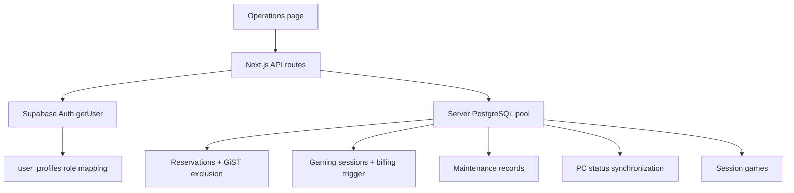

# Operations architecture

Supabase Auth authenticates identity. The server loads the matching `user_profiles` record and applies role guards. The server-only PostgreSQL pool performs application data access. Database constraints and triggers enforce reservation/session conflicts, billing snapshots and PC status synchronization independently of UI behavior.
